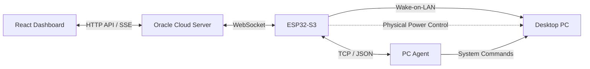
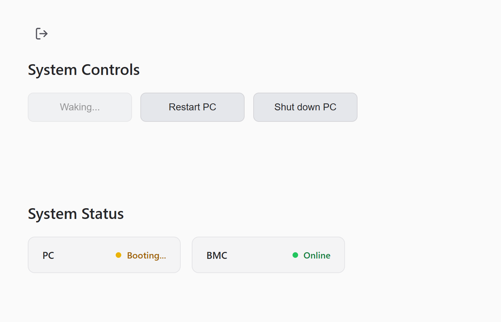
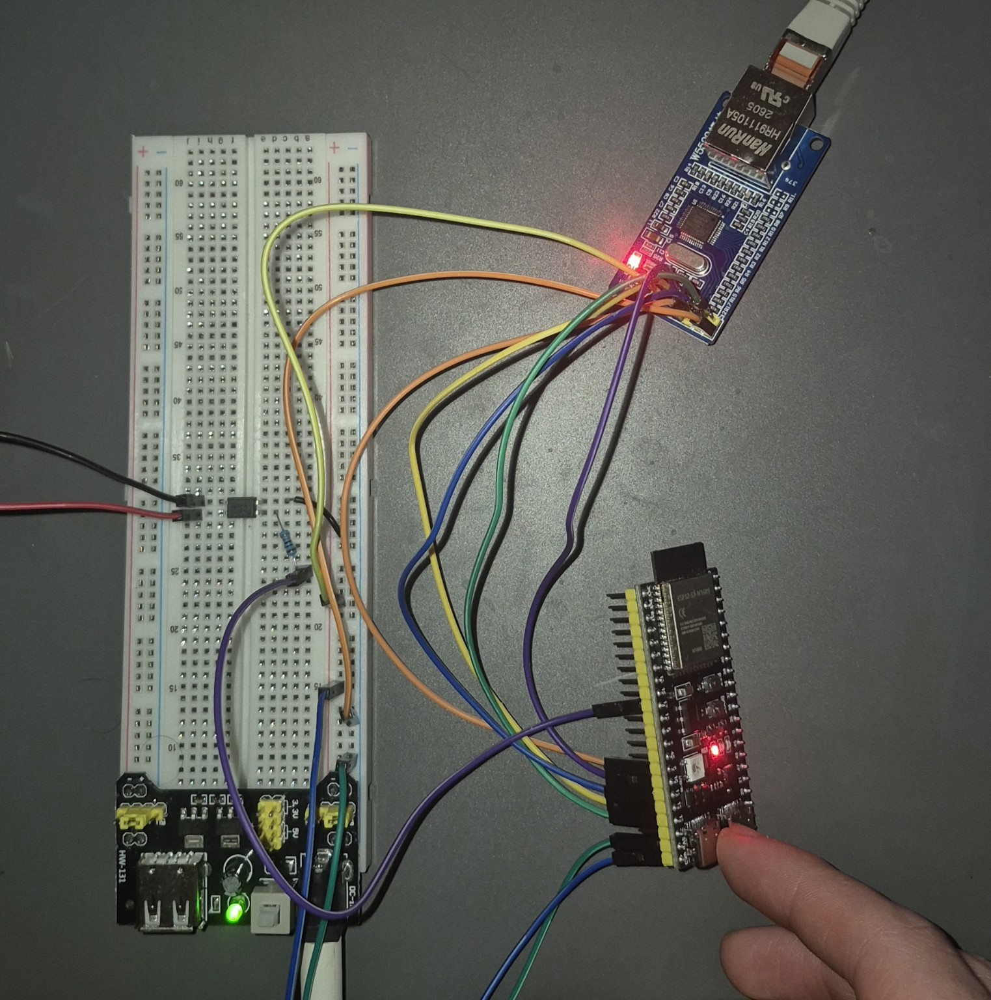

# BMC - Remote PC Management

A custom remote PC management system built around an ESP32-S3, Go services and a React frontend.

The original goal was simple, I wanted to be able to turn on and manage my desktop remotely, even when its operating system wasn't running.

What started as a small ESP32 project has gradually evolved into a distributed system involving embedded firmware, a cloud server, a local PC agent and a web dashboard.

The system currently supports remote power management, device monitoring, Ethernet/Wi-Fi failover, reliable message delivery, asynchronous response tracking and live device-state synchronisation.

I'm using the project to explore embedded development, networking, concurrency, distributed systems and eventually custom hardware design.

### What is a BMC?

**BMC stands for Baseboard Management Controller.**

In enterprise servers, a BMC is a dedicated management controller that operates independently of the main operating system. It provides administrators with out-of-band access to hardware functionality, such as power management, monitoring and remote recovery.

This is particularly useful when a server's operating system crashes or becomes unreachable.

My implementation follows the same general principle, but uses an ESP32-S3 to bring some of these capabilities to a consumer desktop.

Rather than implementing a complete enterprise BMC with features such as IPMI, Redfish or remote KVM, the project focuses on building a lightweight, extensible remote-management system around hardware I already own.

The ESP32 remains available independently of the PC's operating system, allowing it to manage the computer even when the local software agent is unavailable.

---

## How It Works

The system consists of four main applications and a shared protocol library.



The ESP32 serves as the bridge between the remote Oracle server and the local PC.

Rather than exposing the desktop directly to the internet, the ESP32 establishes an outbound WebSocket connection to the Oracle server.

The React dashboard communicates with Oracle, which forwards management commands to the ESP32.

Depending on the requested operation, the ESP32 can communicate with the PC agent, send a Wake-on-LAN packet or use its physical power-control circuitry.

### Starting the PC

When a user presses Wake:

1. The browser sends the command to the Oracle server.
2. Oracle forwards the request to the ESP32.
3. The ESP32 sends a Wake-on-LAN packet over the local network.
4. Oracle transitions the PC into a **Booting** state.
5. The system monitors the PC agent's availability.
6. Once the agent reconnects, the PC is marked **Online**.

The PC has a 50-second startup window. If the agent becomes available sooner, the dashboard immediately updates to reflect this.

On my current desktop, the PC agent becomes available approximately 43 seconds after a Wake-on-LAN request, including the GRUB timeout and Linux startup.

Currently, the system uses the PC agent's availability to confirm that startup has completed. In the future, I want to investigate using the motherboard's internal USB headers to detect earlier stages of the boot process, allowing the BMC to distinguish between the computer powering on, the operating system starting and the PC agent becoming available.

### Shutting Down and Restarting

When the PC agent is available, Oracle can request a graceful shutdown or restart.

These commands travel through the ESP32 to the Go agent running on the PC, which requests the corresponding operation through systemd.

The physical power-control circuit provides an alternative when software-based control is unavailable, although it is not currently connected to the deployed PC.

### Device States

An important part of the design is distinguishing between a device being offline and the system being unable to determine its state.

The PC supports four states:

| State | Meaning |
|---|---|
| **Online** | The PC agent is responding. |
| **Offline** | The PC is known to be unavailable. |
| **Booting** | A startup request has been issued and the system is waiting for the agent. |
| **Unknown** | The BMC cannot currently determine the PC's state. |

The BMC itself is monitored separately and can be reported as online or offline.

These states are maintained by the backend rather than independently by each browser.

The Go backend publishes device-state updates through server-sent events (SSE), allowing multiple connected dashboards to remain synchronised.

For example, if I start the PC from my phone, the dashboard on my laptop will also display the Booting state.

Refreshing a dashboard doesn't restart the boot timer or lose the current state.

---

## Demo

The web dashboard provides remote power controls, device availability information and error reporting.

### Web Dashboard



*The dashboard during a Wake-on-LAN operation. The PC is booting while the BMC remains online and monitors startup progress.*

The dashboard supports authenticated access, remote power controls, device-state monitoring and error notifications.

State changes are distributed to connected clients through the Oracle server, ensuring that multiple browser sessions reflect the same device information.

---

## Hardware Prototype

The current hardware prototype is built around an ESP32-S3 development board, a W5500 Ethernet controller and an optocoupler-based motherboard power-control circuit.

The breadboard setup has been used to develop and test the firmware before moving towards a dedicated PCB.

### Breadboard Prototype



*The current breadboard prototype containing the ESP32-S3, W5500 Ethernet module and supporting circuitry.*

Before moving to a custom PCB, I'd like to extend the prototype with a display for local device monitoring and a second optocoupler to provide feedback on whether the power-control signal was successfully activated.

### Physical Power Control

One of the original goals was to make the BMC capable of managing the PC independently of its operating system or Wake-on-LAN. This was motivated by an experience when I was accessing my PC remotely while away from home. The system crashed and became completely unresponsive, leaving me with no way to recover it remotely.

I suspect the crash was caused by a memory management issue, as the system had limited available RAM while VRAM was simultaneously being pushed to its limits when training an AI model. However, I never confirmed the exact cause as it has never happened again. (Heisenbug :D)

This experience highlighted the limitations of relying entirely on software-based remote management. If the operating system becomes unresponsive, the management software becomes unavailable too. I wanted a way to recover the PC even in those circumstances, which led to implementing physical power control through the ESP32.

To achieve this, I implemented a physical power-control circuit using PC817 optocouplers.

The circuit simulates pressing the motherboard's power button by controlling the corresponding switch contacts.

The implementation supports three operations:

| Operation | Behaviour |
|---|---|
| **Power On** | Briefly activates the motherboard's power-switch contacts. |
| **Power Off** | Holds the power switch to request a forced shutdown. |
| **Reset** | Performs a complete power-off and power-on cycle. |

The reset implementation does not use the motherboard's dedicated reset pins as they do not work. Instead, it uses the existing power-control circuit to cycle the PC's power.

**The physical power-control system has already been implemented and successfully tested.**

It is currently disconnected from the PC, so the deployed system uses Wake-on-LAN and software-based shutdown/restart through the PC agent.

The remaining work involves integrating the existing circuitry into the final hardware configuration and deciding when physical power control should be selected automatically.

---

## Engineering Features

### 1. Custom Communication Protocol

The project uses a custom JSON-based communication protocol implemented in both Go and C++.

The Go implementation is shared between the Oracle server and PC agent, while the ESP32 firmware contains a corresponding C++ implementation. Would like to use Protocol Buffers in a later revision or future project though.

Messages contain unique identifiers, timestamps, message types and optional references to earlier messages.

A major design decision was separating **message delivery from operation completion**.

For example, receiving an acknowledgement for a Wake-on-LAN command only confirms that the command was received. It does not prove that the PC has successfully booted.

The protocol supports:

- Unique message identifiers and response correlation.
- Acknowledgement tracking.
- Configurable timeouts and retry policies.
- Asynchronous response tracking.
- Message deduplication.
- Error reporting and command results.
- Thread-safe management of pending messages.

Acknowledgements and responses serve different purposes.

**Acknowledgement:** Confirms that a message was received.

**Response:** Reports the result of a request or operation.

This distinction is especially important for operations that may take time or terminate the software responsible for executing them.

For example, a successful shutdown may terminate the PC agent before it can return an execution result.

Consequently, the system uses subsequent device-state observations to determine whether the expected state change occurred.

One of the biggest benefits of this architecture, in my opinion, is how easily it can be extended. Currently, the system primarily reports PC availability, but adding telemetry or other functionality should only require implementing the new message handlers. The underlying communication infrastructure, including acknowledgements, response tracking, retries and deduplication, can remain unchanged.

### 2. Ethernet and Wi-Fi

The ESP32 supports both Ethernet and Wi-Fi connectivity. The main reason for implementing Ethernet is that the Wi-Fi signal in the room where the ESP32 operates is quite poor, making a wired connection much more reliable.

However, since I had already implemented Wi-Fi connectivity during the early stages of development, I decided to retain it as a fallback. This allows the ESP32 to switch to Wi-Fi if the Ethernet connection becomes unavailable, such as when someone accidentally unplugs the cable.

Ethernet communication is provided through a W5500 controller, while Wi-Fi is available as a fallback.

Implementing both interfaces introduced several interesting problems beyond simply establishing network connectivity.

The firmware needs to:

- Select an available network interface.
- Detect network changes.
- Re-establish connections when the active interface changes.
- Prevent stale connections from interfering with new sessions.
- Maintain application-level communication independently of the active network transport.

The firmware uses network generation tracking to notify communication tasks when the underlying connection changes.

This allows the Oracle WebSocket and PC-agent TCP connections to be recreated without requiring the application logic to know which network interface is currently active.

The goal is to make network management a reusable part of the firmware rather than something every feature needs to implement independently.

### 3. Concurrent ESP32 Firmware

The firmware uses FreeRTOS to separate different responsibilities into independent tasks.

These include network management, Oracle communication, local PC-agent communication and asynchronous logging.

This allows the ESP32 to maintain external communication while independently handling local operations.

Shared resources require synchronisation, particularly around network clients and message tracking.

One of the more interesting challenges has been ensuring that connection changes, incoming packets and outgoing commands don't interfere with one another.

### 4. Device-State Management

The Oracle server maintains the current device states and distributes updates to connected dashboards.

This is intentionally handled by the backend rather than by the frontend.

For example, when a wake command is issued, Oracle manages the startup deadline and publishes state changes.

A browser doesn't need to independently calculate when the PC should finish booting.

This also means multiple clients can observe the same operation without creating separate timers or conflicting assumptions about the PC's state.

The system distinguishes between command acknowledgement, device availability and successful state transitions.

### 5. Error Handling and Recovery

Because the system communicates across multiple devices and networks, communication failures are an expected part of its operation.

The protocol and application layers account for:

- Messages that aren't acknowledged.
- Responses that arrive late or never arrive.
- Duplicate messages.
- Network disconnections.
- Devices becoming unavailable.
- Commands that cannot be executed.
- Startup operations that exceed their deadline.

The intention is to report meaningful failures to the user while keeping the underlying communication infrastructure reusable.

---

## Project Components

The project is split across five repositories, managed as Git submodules.

| Component | Responsibility | Documentation |
|---|---|---|
| **ESP32 Firmware** | Network management, Wake-on-LAN, physical power control and communication with Oracle and the PC agent. | [ESP32 README](esp32/README.md) |
| **Oracle Server** | Authentication, command routing, device-state management, message tracking and frontend updates. | [Oracle README](oracle-server/README.md) |
| **PC Agent** | Local system management, command execution and PC availability reporting. | [PC Agent README](pc-agent/README.md) |
| **Go Protocol** | Shared packet definitions, serialisation, acknowledgements, response tracking and deduplication. | [Protocol README](go-protocol/README.md) |
| **Frontend** | React dashboard, authentication, power controls and live device-status information. | [Frontend README](frontend/README.md) |

The components are developed separately but integrated through the parent BMC repository.

Git submodules allow the parent repository to pin specific revisions of each component, helping ensure that deployments use mutually compatible versions.

---

## Development Setup

Clone the repository and initialise its submodules:

```bash
git clone --recurse-submodules https://github.com/CiaranW005/BMC.git
cd BMC
```

For an existing checkout:

```bash
git submodule update --init --recursive
```

The repository includes `BMC.code-workspace` for working across the components.

A root `go.work` file links the Go modules during local development.

### Technologies

| Component | Technologies |
|---|---|
| ESP32 Firmware | C++17, Arduino, FreeRTOS, PlatformIO |
| Oracle Server | Go 1.26 |
| PC Agent | Go 1.26 |
| Go Protocol | Go |
| Frontend | React, TypeScript, Node.js 22 |
| Microcontroller | ESP32-S3 |
| Ethernet | W5500 |
| Physical Power Control | PC817 optocouplers |
| Cloud Infrastructure | Oracle Cloud |
| Reverse Proxy | Caddy |

Each component has its own configuration and dependencies.

Local network addresses, authentication credentials, hardware pin assignments and deployment settings must be configured for the target environment.

Refer to the component READMEs for their individual setup and build instructions.

---

## Deployment

The parent repository contains the GitHub Actions workflows used to build and deploy the system.

### Oracle Server

The Oracle deployment workflow builds the Go backend and React frontend before transferring the required artifacts to the Oracle VM.

The deployment script installs the updated files and restarts the relevant services.

Production communication uses a reverse proxy to handle external HTTPS and WebSocket traffic.

The ESP32 uses client-certificate authentication for its production connection.

The deployment scripts expect a configured Caddy installation. The required `deployment/caddy/Caddyfile` is not included in the current checkout and must be supplied before using the deployment script as provided.

### PC Agent

The PC-agent workflow builds a Linux AMD64 executable and publishes it through GitHub Releases.

The release includes a SHA-256 checksum.

The PC's update process retrieves the published executable before starting the agent.

### Version Management

The parent BMC repository pins the submodule revisions used by its deployment workflows.

This is important because the Go protocol, Oracle server and PC agent must remain compatible.

Deployments should use the selected submodule commits rather than automatically fetching the latest version of each component.

---

## Future Development

Although the core remote-management functionality is operational, there are several areas I want to expand.

Some are relatively straightforward software additions, while others will require new hardware and mechanical design work.

### 1. System Telemetry

The next major software feature is extending the existing monitoring system to report hardware diagnostics.

Currently, the system primarily monitors device availability.

I want to extend this to include:

- CPU utilisation and temperature.
- GPU utilisation and temperature.
- RAM and VRAM usage.
- System uptime.
- Potentially process-level information and application events.

The intended telemetry polling interval is approximately 1.5 seconds.

Telemetry would also act as the primary indication that the PC agent is responsive.

If telemetry stops responding, the system could fall back to a lightweight heartbeat to distinguish a monitoring failure from a complete loss of connectivity.

### 2. Physical Power Integration

Although the physical power-control circuit is already working, it is not currently attached to the deployed PC.

The next stage is integrating it into the permanent hardware setup.

I also want to investigate fallback between Wake-on-LAN and physical power control. However, this introduces an interesting problem: determining why a Wake-on-LAN request failed.

If the PC agent doesn't reconnect after a wake request, it doesn't necessarily mean the PC failed to power on. The machine could be booting, stuck during startup or experiencing an operating-system failure.

Similarly, Wake-on-LAN might fail because of network configuration, a disconnected Ethernet cable or the motherboard not responding to the magic packet.

Automatically activating the physical power button without knowing the PC's actual state could accidentally shut down a machine that is already running.

For this reason, I'd initially prefer a user-confirmed physical fallback while investigating additional hardware feedback to distinguish between power states and operating-system availability.

### 3. Custom PCB

The current implementation uses development boards and a breadboard.

Eventually, I want to replace these with a custom PCB integrating the required components.

This will involve designing the circuitry, laying out the board and considering power delivery, isolation, connectors and mechanical mounting.

The aim is to turn the current prototype into a more compact and permanent device.

### 4. 3D-Printed Enclosure

I'm also planning to design and 3D-print a dedicated enclosure.

Originally, I considered mounting the BMC internally using an available PCIe slot.

However, an internal design introduces some mechanical constraints, particularly around GPU airflow and cable routing.

I'm now considering an external enclosure connected to the PC through a custom 3D-printed PCIe passthrough bracket.

The cables would be routed securely along the bottom of the PC case, allowing the controller to remain outside without leaving unsecured wiring near the GPU fans.

This also provides more flexibility for the display and overall enclosure design.

### 5. Animated Laboratory Assistant

One of the more experimental ideas I'd like to explore is giving the BMC its own animated character.

Instead of using the onboard display exclusively for technical information, I want to create a small laboratory assistant whose behaviour changes depending on what the PC is doing.

The idea is to have a miniature scientist working in a laboratory, reacting to real system events.

For example:

| System Event | Animation |
|---|---|
| PC idle | Scientist relaxing or working quietly. |
| High CPU/GPU utilisation | Taking notes or checking experiments. |
| Wake-on-LAN requested | Picking up a telephone and calling the PC. |
| Physical power-on | Connecting two enormous power cables. |
| Reset requested | Operating a large reset lever. |
| PC successfully boots | Celebrating. |
| Network connection lost | Searching for a connection. |
| Application crash | Laboratory equipment falling apart. |
| Serious system failure | Laboratory destroyed, scientist crying on the floor. |

The animations would ideally correspond to actual BMC operations rather than being purely random.

For example, sending a Wake-on-LAN packet could trigger the telephone animation. If that fails and physical power control is used, the scientist could switch to connecting the power cables.

For the hardware, I'm considering either one larger display or two separate displays.

One could show the animated laboratory, while the other remains dedicated to telemetry.

I also like the idea of having the scientist occasionally interact with the telemetry interface, such as pulling down a screen to inspect system performance.

The main goal is to keep the device useful as a hardware monitor while giving it some personality.

### 6. Protocol and Infrastructure Improvements

As the project grows, there are several areas of the underlying software I'd like to revisit.

These include:

- Replacing periodic timeout scans with an event-driven deadline scheduler.
- Improving the organisation of larger firmware components.
- Expanding automated testing across the Go and C++ protocol implementations.
- Documenting concurrency assumptions and failure-handling behaviour.
- Improving recovery from unexpected network and device failures.

One of my goals is to build infrastructure that remains useful as I add more features.

I'd rather have reliable, reusable communication and tracking systems than repeatedly implement similar functionality throughout the project.

---

## Project Direction

This project started as a relatively small experiment in remotely powering on my desktop.

Over time, it has become an opportunity to explore several areas of engineering that I find interesting, from embedded networking and distributed communication to hardware design and user interfaces.

I don't have a fixed definition of what the finished system needs to look like.

Part of the appeal is being able to experiment with new features, revisit design decisions and gradually develop the project into something more capable.

For now, the main priorities are extending telemetry, integrating the existing physical power-control circuitry and beginning work on the custom hardware.

Eventually, I'd like to have a dedicated little device sitting beside my computer, monitoring its performance, managing its power and occasionally showing an increasingly overworked scientist trying to keep everything running.